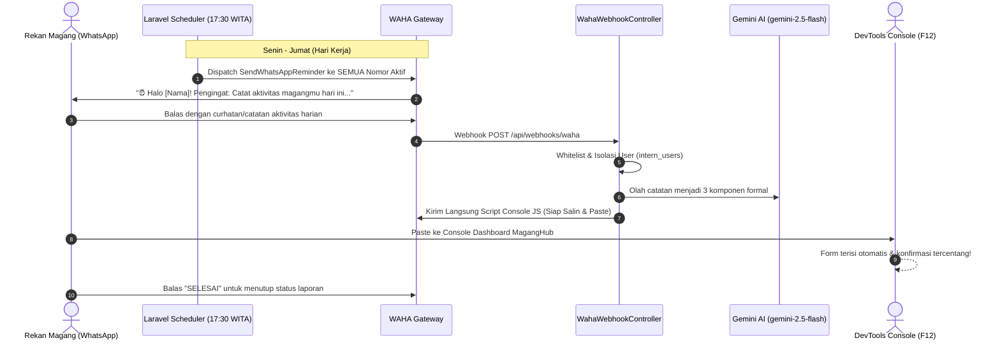

# Walkthrough: Sistem Otomasi Laporan MagangHub via WhatsApp & Script Console Generator (Multi-User)

Sistem otomasi laporan harian MagangHub telah selesai dibangun dengan arsitektur praktis, efisien, mendukung banyak pengguna (rekan magang), dan menghasilkan script browser console siap-paste secara instan.

---

## 🚀 Alur Kerja yang Diimplementasikan



---

## 🛠️ Komponen yang Dibuat

1. **[`InternUser`](file:///C:/laragon/www/absen-maganghub/app/Models/InternUser.php)**
   - Mengelola profil rekan magang: `name`, `phone_number`, `is_active`, dan `notes`.
   - Menggabungkan daftar nomor aktif dari database dan `.env` (`USER_PHONE_NUMBERS`).
   - Normalisasi nomor format Indonesia (`08...` -> `628...`).

2. **[`ScriptBuilderService`](file:///C:/laragon/www/absen-maganghub/app/Services/ScriptBuilderService.php)**
   - Merangkai script JavaScript DOM injection berbasis template yang kamu berikan:
     ```javascript
     const values = {
       uraianAktivitas: `...`,
       pembelajaran: `...`,
       kendala: `...`
     };
     const textareas = document.querySelectorAll('.daily-form textarea');
     const fields = ['uraianAktivitas', 'pembelajaran', 'kendala'];
     textareas.forEach((textarea, index) => {
       const key = fields[index];
       if (key && values[key]) {
         textarea.value = values[key];
         textarea.dispatchEvent(new Event('input', { bubbles: true }));
         textarea.dispatchEvent(new Event('change', { bubbles: true }));
       }
     });
     document.querySelector('.review-confirmation input')?.click();
     ```
   - Sanitasi otomatis karakter `` ` `` dan `${...}`.

3. **[`ReportGeneratorService`](file:///C:/laragon/www/absen-maganghub/app/Services/ReportGeneratorService.php)**
   - Terintegrasi dengan Google Gemini API (`gemini-2.5-flash`).
   - Menyusun 3 bagian resmi logbook (*Uraian Aktivitas*, *Pembelajaran*, *Kendala*).

4. **[`GenerateDailyReport`](file:///C:/laragon/www/absen-maganghub/app/Jobs/GenerateDailyReport.php)**
   - Mengirim **dua pesan WhatsApp berturut-turut**:
     - *Pesan 1*: Rangkuman draf 3 bagian.
     - *Pesan 2*: Script JavaScript utuh (*One-Tap Copy*).

5. **[`WahaWebhookController`](file:///C:/laragon/www/absen-maganghub/app/Http/Controllers/WahaWebhookController.php)**
   - Whitelist authorization dinamis menggunakan `InternUser::isPhoneAuthorized()`.
   - Isolasi draf dan riwayat status per nomor pengirim.
   - Penanganan interaktif:
     - Catatan biasa: Generate draf + script console.
     - `EDIT: [catatan]`: Revisi otomatis oleh AI dan kirim ulang script.
     - `SCRIPT` / `ULANG`: Kirim ulang script console hari ini.
     - `SELESAI`: Menandai laporan berstatus `submitted`.
     - `BATAL`: Membatalkan laporan hari ini.

6. **[`SendWhatsAppReminder`](file:///C:/laragon/www/absen-maganghub/app/Jobs/SendWhatsAppReminder.php) & [`routes/console.php`](file:///C:/laragon/www/absen-maganghub/routes/console.php)**
   - Mengirim pengingat sore pukul **17:30 WITA** ke seluruh nomor aktif.
   - Melewati pengguna yang sudah menyelesaikan laporan hari ini.
   - Menyediakan perintah CLI ramah pengguna:
     - `php artisan app:add-user {nama} {nomor} {--notes=}` -> Mendaftarkan nomor baru.
     - `php artisan app:list-users` -> Menampilkan tabel semua nomor terdaftar.
     - `php artisan app:remove-user {nomor}` -> Menonaktifkan nomor.
     - `php artisan app:send-reminder-test {nomor?}` -> Uji pengingat instan.
     - `php artisan app:maganghub-status` -> Memantau status laporan harian semua pengguna.

7. **[`docker-compose.yml`](file:///C:/laragon/www/absen-maganghub/docker-compose.yml)**
   - Setup container WAHA (WhatsApp HTTP API) siap pakai pada port `3000`.

---

## 🧪 Hasil Verifikasi & Pengujian

Semua unit dan feature test berjalan sukses 100%:
```sh
php artisan test --compact
```
**Hasil:**
```json
{"tool":"phpunit","result":"passed","tests":15,"passed":15,"assertions":54,"duration_ms":751}
```

### Rincian Skenario yang Diverifikasi:
- ✅ Pendaftaran user baru via CLI `php artisan app:add-user`.
- ✅ Pengingat multi-user (broadcast ke semua nomor aktif dan skip yang sudah submit).
- ✅ Isolasi laporan antar pengguna (aksi User A tidak mengubah laporan User B).
- ✅ Sanitasi backtick dan template literal di `ScriptBuilderService`.
- ✅ Filter pesan bot sendiri (`fromMe = true`) dan nomor tidak terdaftar.
- ✅ Formatting standar Laravel Pint (`vendor/bin/pint --format agent`).

---

## 📋 Panduan Manajemen Nomor & Menjalankan Sistem

### 1. Mendaftarkan Nomor WhatsApp Pengguna
Kamu dapat mendaftarkan nomor sebanyak mungkin dengan perintah CLI:
```powershell
php artisan app:add-user "Awang" "081234567890" --notes="Lead Developer"
php artisan app:add-user "Rekan 1" "089876543210" --notes="Frontend"
```

Untuk melihat semua nomor yang aktif:
```powershell
php artisan app:list-users
```

*(Kamu juga bisa menambahkan nomor cadangan langsung di `.env` pada variabel `USER_PHONE_NUMBERS=628111,628222`)*

### 2. Nyalakan WAHA Container
```powershell
docker compose up -d
```
Buka `http://localhost:3000/dashboard`, scan QR Code dengan akun WhatsApp bot pengirim.

### 3. Jalankan Laravel API & Queue Worker
- Tab Terminal 1:
  ```powershell
  php artisan serve
  ```
- Tab Terminal 2:
  ```powershell
  php artisan queue:work
  ```

### 4. Uji Pengingat ke Semua Nomor
```powershell
php artisan app:send-reminder-test
```
Setiap nomor yang terdaftar akan menerima pesan WhatsApp pengingat personal pada jam 17:30 WITA!
