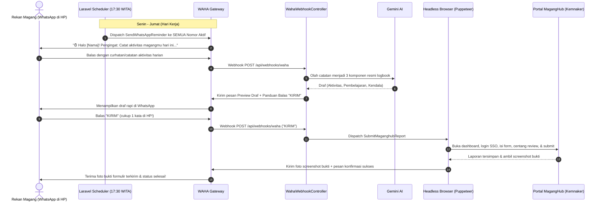

# Walkthrough: Sistem Otomasi Laporan MagangHub via WhatsApp & Headless Browser (Opsi 1)

Sistem otomasi laporan harian MagangHub kini telah diupgrade ke **Opsi 1 (Full Server-Side Automation)**. Rekan magang **tidak perlu lagi membuka laptop, membuka DevTools, atau copy-paste script apapun**. Seluruh proses pengisian dan pengiriman laporan dapat diselesaikan langsung 100% dari ruang obrolan **WhatsApp di HP**.

---

## 🚀 Alur Kerja yang Diimplementasikan (Opsi 1)



---

## 🛠️ Komponen yang Dibuat & Diperbarui

1. **[`scripts/maganghub-automator.mjs`](file:///C:/laragon/www/absen-maganghub/scripts/maganghub-automator.mjs)**
   - Menggunakan `puppeteer-core` terintegrasi dengan Google Chrome / Edge bawaan sistem atau Chromium Docker.
   - Mendukung dua mode:
     - **Mode Headless**: Login otomatis SSO Kemnaker (`account.kemnaker.go.id`), membuka dashboard, menginjeksi 3 textareas, mencentang konfirmasi, menekan tombol kirim, dan mengambil screenshot bukti pengisian.
     - **Mode Sesi (`storageState`)**: Membaca dan menyimpan cookies & local storage sehingga tidak perlu login ulang berkali-kali.

2. **[`MagangHubAutomationService`](file:///C:/laragon/www/absen-maganghub/app/Services/MagangHubAutomationService.php)**
   - Service Laravel yang menjalankan script Node.js via Symfony `Process`.
   - Mengatur input STDIN JSON secara aman dan menangkap output JSON (`success`, `screenshot`, `message`, `error`).

3. **[`SubmitMaganghubReport`](file:///C:/laragon/www/absen-maganghub/app/Jobs/SubmitMaganghubReport.php)**
   - Queue Job yang mengeksekusi automasi headless browser.
   - Jika sukses: Mengupdate status laporan menjadi `submitted`, mencatat waktu `submitted_at`, dan mengirimkan foto screenshot bukti pengisian via WAHA (`sendImage`).
   - Jika gagal: Memberitahukan alasan kendala dan mengirimkan **cadangan script console** sebagai fallback darurat agar pengguna tidak pernah terhambat.

4. **[`GenerateDailyReport`](file:///C:/laragon/www/absen-maganghub/app/Jobs/GenerateDailyReport.php)**
   - Menghasilkan draf 3 poin (Aktivitas, Pembelajaran, Kendala) dengan Gemini AI.
   - Mengirimkan draf dalam format pratinjau yang bersih ke WhatsApp pengguna dengan panduan aksi:
     - Balas **`KIRIM`** 👉 Submit otomatis ke MagangHub tanpa buka web.
     - Balas **`EDIT: [catatan]`** 👉 Revisi draf.
     - Balas **`SCRIPT`** 👉 Meminta script console jika ingin manual.

5. **[`WahaWebhookController`](file:///C:/laragon/www/absen-maganghub/app/Http/Controllers/WahaWebhookController.php)**
   - Mendukung perintah instan via WhatsApp:
     - `AKUN: email password` 👉 Simpan/update akun MagangHub langsung via chat WhatsApp (tersimpan terenkripsi).
     - `KIRIM` / `SUBMIT` 👉 Menjalankan automasi headless browser.
     - `SELESAI` 👉 Konfirmasi manual jika pengguna memilih isi sendiri di PC.
     - `EDIT: ...` 👉 Revisi draf berbasis AI.
     - `SCRIPT` 👉 Kirim ulang script console.
     - `BATAL` 👉 Membatalkan draf laporan hari ini.

6. **[`InternUser`](file:///C:/laragon/www/absen-maganghub/app/Models/InternUser.php)**
   - Ditambahkan field `maganghub_email` dan `maganghub_password` (dienkripsi otomatis oleh Laravel via `casts`).
   - Ditambahkan helper `getSessionFilePath()` untuk penyimpanan cookies sesi per nomor.

7. **Perintah CLI Baru di [`routes/console.php`](file:///C:/laragon/www/absen-maganghub/routes/console.php)**
   - `php artisan app:add-user {nama} {nomor} {--email=} {--password=}`: Mendaftarkan nomor sekaligus akun MagangHub.
   - `php artisan app:set-credentials {nomor} {email} {password}`: Mengatur/mengubah akun MagangHub rekan magang.
   - `php artisan app:maganghub-login {nomor}`: Membuka browser interaktif untuk login manual dan otomatis menyimpan session cookies.
   - `php artisan app:submit-report {nomor}`: Menguji langsung pengiriman headless browser hari ini via CLI.
   - `php artisan app:list-users`: Menampilkan status akun MagangHub (kredensial terdaftar / sesi aktif).

---

## 🧪 Hasil Pengujian & Verifikasi

Seluruh test suite berjalan sukses 100% tanpa error:
```sh
php artisan test --compact
```
**Hasil:**
```json
{"tool":"phpunit","result":"passed","tests":21,"passed":21,"assertions":81,"duration_ms":861}
```

Daftar pengujian yang diverifikasi:
- ✅ Pratinjau draf laporan AI dengan petunjuk one-tap `KIRIM`.
- ✅ Pengiriman webhook dengan pesan `KIRIM` men-dispatch `SubmitMaganghubReport`.
- ✅ Pendaftaran kredensial via chat WhatsApp `AKUN: email password`.
- ✅ Eksekusi `SubmitMaganghubReport` sukses mengirim foto screenshot bukti dan mengubah status ke `submitted`.
- ✅ Penanganan error `SubmitMaganghubReport` jika sesi kedaluwarsa dengan fallback script otomatis.
- ✅ Standar kode PHP diformat dengan Laravel Pint (`vendor/bin/pint --format agent`).

---

## 📱 Panduan Penggunaan Rekan Magang (Dari HP)

### 1. Menyimpan Sesi Login MagangHub (Cukup 1x di Laptop/Server)
Demi keamanan, sistem tidak perlu menyimpan password akun. Rekan magang cukup login sekali melalui browser interaktif:
```powershell
php artisan app:maganghub-login "081234567890"
```
Browser Chrome akan terbuka otomatis. Silakan login ke portal Kemnaker hingga mencapai dashboard MagangHub. Script akan otomatis mendeteksi dan menyimpan cookies sesi. Setelah tersimpan, sesi ini dipakai terus untuk pengiriman harian!

Jika sewaktu-waktu sesi habis/kedaluwarsa, bot WhatsApp akan otomatis memberitahukan untuk login manual kembali dan tetap menyertakan script console cadangan agar laporan tidak terhambat.

### 2. Mengirim Catatan Harian
Pukul 17:30 WITA, bot mengirim pengingat. Rekan magang cukup membalas curhatan/kegiatan hari ini:
> *"Hari ini saya slicing tampilan figma halaman dashboard dan integrasi API login."*

### 3. Review & Kirim Laporan
Bot akan membalas dengan draf 3 poin resmi. Rekan magang cukup membalas:
```text
KIRIM
```
Server akan membuka portal MagangHub di latar belakang, mengisi formulir, mencentang konfirmasi, mengirim laporan, lalu **mengirimkan foto screenshot bukti pengisian ke WhatsApp rekan magang**. Selesai tanpa perlu menyentuh browser!
